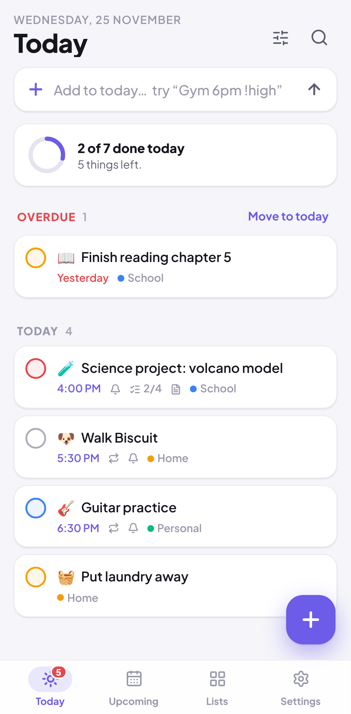
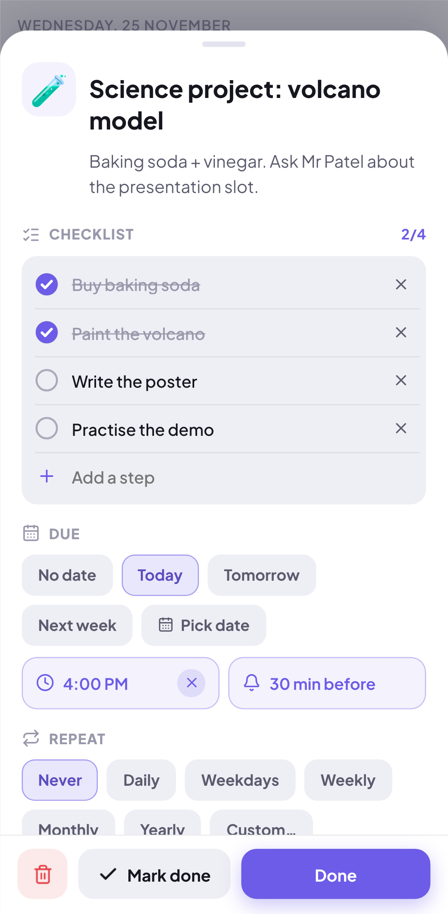
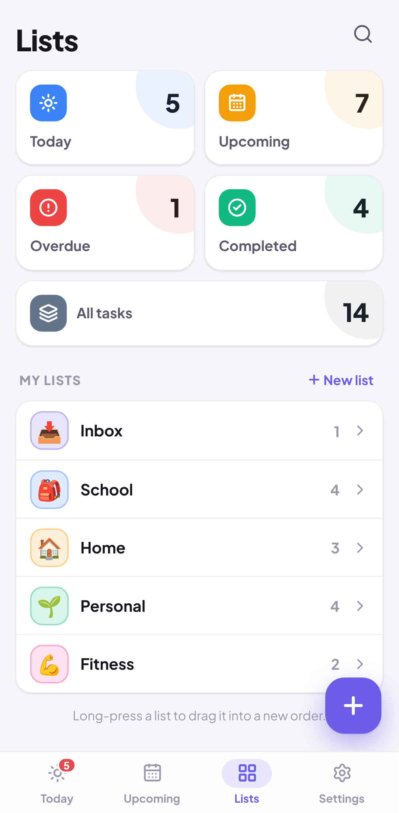
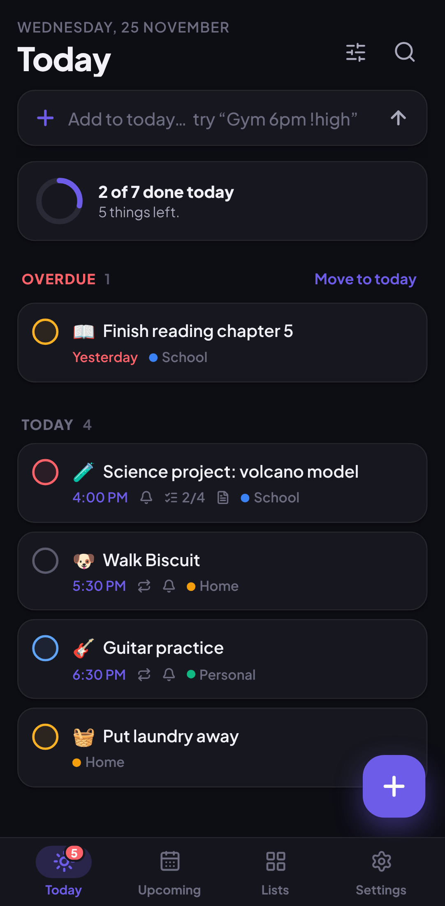

# ✅ Doable

**A free, offline, no-subscription to-do app for Android.** Everything the paid apps charge for, for free: lists, subtasks, repeating tasks, real reminders, smart views, search, drag-to-reorder, dark mode and backups. No account, no ads, no cloud. Your tasks live on your phone.

<p>
  
  
  
  
</p>

## 📲 Install on your phone

**Download link (always the newest version):**
https://github.com/tobyhome12345-commits/To-do-game/releases/latest/download/Doable.apk

1. Open the link above in **Chrome** on your Android phone. `Doable.apk` downloads.
2. Tap the download notification, or open **Files → Downloads → Doable.apk**.
3. If Android says *"For your security, your phone isn't allowed to install unknown apps from this source"*, tap **Settings**, turn on **Allow from this source**, then go back.
4. Tap **Install**, then **Open**.
5. When you set your first reminder, tap **Allow** so Doable can send notifications.

**Updating:** open the same link again and install. It installs over the old version and **keeps all your tasks**, because every build is signed with the same key.

> 💡 Tip: go to **Settings → Export backup** now and then, and save the file to Google Drive. If you ever change phones, use **Import backup** on the new one.

## ✨ Features

| | |
|---|---|
| ✏️ **Tasks** | Title, notes, due date & time, priority (none/low/medium/high), emoji, checklist of subtasks |
| ⚡ **Quick-add bar** | Type and hit Enter. Understands `tomorrow 5pm`, `fri`, `next week`, `dec 25`, `!high`, `#School`, `every mon`, `every 3 days`… |
| 🎉 **Tick animation** | The check draws itself, confetti pops, and the row slides away. **Undo** for 5 seconds |
| 🗂️ **Lists** | Inbox + your own lists (Home, School…) with custom colours and emoji. Drag to reorder |
| 🧠 **Smart views** | Today (with Overdue), Upcoming (2-week strip), Overdue, Completed, All tasks |
| 🔁 **Repeating tasks** | Daily, weekdays, weekly, monthly, yearly, or custom: every N days/weeks/months/years, pick weekdays, repeat from the due date or from when you finish it, optional end date |
| 🔔 **Real reminders** | Android notifications at the exact minute, even when the app is closed, with ✓ Done and Snooze buttons. They survive a restart |
| 🔍 **Search, filter, sort** | Searches titles, notes and checklists. Filter by priority, list or due date. Sort by your order, due date, priority, list, newest or A–Z |
| ✋ **Drag to reorder** | Long-press any task or list and drag |
| 💾 **Offline + backups** | Saved on the device. Export/import JSON backups (merge or replace) |
| 🌙 **Looks good** | Phone-first design, dark mode (auto/light/dark), and any accent colour you like |

### Quick-add cheat sheet

| Type | Gets |
|---|---|
| `Essay tomorrow 5pm !high #School` | Due tomorrow 5:00 PM, high priority, in School |
| `Gym every mon 7am` | Repeats every Monday at 7:00 AM |
| `Water plants every 3 days` | Repeats every 3 days, starting today |
| `Call grandma fri at 6` | Due Friday 6:00 PM |
| `Party 25 dec` / `dec 25` | Due 25 December |
| `Revise in 2 weeks` / `next week` | Relative dates |
| `!` `!!` `!!!` or `!low` `!med` `!high` | Priority |

## 🏗️ How it's built

- **Web app** (React + TypeScript + Vite) wrapped with **Capacitor 8** into a native Android app.
- **Storage:** one JSON document in Android's private app storage (Capacitor Preferences), with a "last good copy" for crash safety.
- **Reminders:** `@capacitor/local-notifications`, which uses real OS alarms (`AlarmManager`), exact timing via `USE_EXACT_ALARM`, and re-scheduling after a reboot.
- **Builds:** GitHub Actions (`.github/workflows/android.yml`) runs the tests, builds and signs the APK, and publishes it to GitHub Releases on every push.

The tricky parts (the data model, repeating tasks and reminders) are explained in **[docs/ARCHITECTURE.md](docs/ARCHITECTURE.md)**.

### Working on it

```bash
npm install
npm run dev          # open http://localhost:5173/?demo=1 for sample data
npm test             # 62 unit tests (repeats, reminders, quick-add, undo, views, backups)
npm run build
```

### ⚠️ The signing key

`android/app/doable-release.jks` and `android/keystore.properties` are committed **on purpose** so GitHub Actions signs every build with the same key. **Never delete or regenerate them.** If the key changes, Android refuses to install updates over the existing app, and you'd have to uninstall it (export a backup first!). Also, don't rename the workflow file, because its run number is the app's version code.
